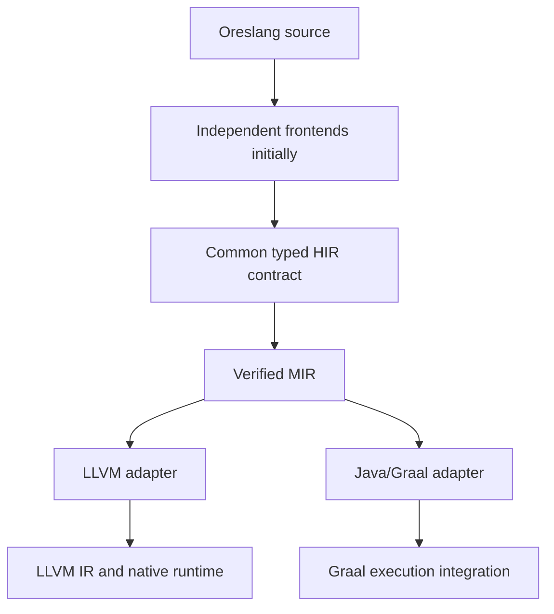

# AttoLang common source

**Status: future architecture and planning only. No shared compiler implementation exists in this repository yet.**

This repository is the intended home for AttoLang's future common semantic compiler layer: **HIR → MIR**, before backend-specific lowering to LLVM and Java/Graal.

For now, the existing implementations remain separate:

| Repository | Responsibility today and during migration |
| --- | --- |
| [oreslang-source.java](https://github.com/ores-truffle-oreslang/oreslang-source.java) | Independent Java/Graal compiler and runtime; later consumes the common representation through its own adapter |
| [oreslang-source.llvm](https://github.com/ores-truffle-oreslang/oreslang-source.llvm) | Independent LLVM compiler and native runtime work; later consumes the common representation through its own adapter |
| [oreslang-source.net](https://github.com/ores-truffle-oreslang/oreslang-source.net) | Independent .NET compiler and runtime; executable source coverage is measured separately |
| **oreslang-common-source** | Future shared semantic representations, HIR → MIR transformations, verifiers, and compatibility contracts |

Creating this repository does not merge the other repositories, change their compiler pins, or establish feature parity. The current public language name is **AttoLang** (formerly Oreslang); old repository names, package coordinates, commands, ABI and protocol identifiers remain compatibility interfaces until separately versioned migrations ship.

The versioned, machine-readable naming and source-compatibility policy is [AttoLang Brand Compatibility v1](contracts/v1/attolang-brand-compat-v1.json). It deliberately distinguishes the public brand from compiler capabilities: `.atto` is the preferred new source extension, but admission and execution must be proven independently in each backend. Existing `.ores` source remains compatible while that work proceeds.

## Core decisions

- Keep **independent compilers and borrow checkers** for now. No backend waits for another to implement a feature.
- Share the language specification, TypeSpec/JSON Schema contracts, source fixtures and conformance expectations immediately.
- Consolidate semantic compiler source here later, starting with a proven HIR → MIR boundary.
- **Trusted code, shared actors and isolated actors must eventually support complete AOT in LLVM.** Equivalent Java/Graal guest-code AOT is a target to prove.
- Untrusted guest code may be JIT-compiled, interpreted under policy, or optionally AOT-compiled. It does not require AOT.
- Trust, actor isolation and compilation strategy are independent policy dimensions.

## Intended pipeline

HIR means **high-level intermediate representation**. MIR means **mid-level intermediate representation**. These names describe this project's proposed compiler stages; they do not imply compatibility with another compiler's IR.

The common layer should preserve one language contract while allowing different execution strategies. LLVM IR is not the common MIR. Java bytecode, Truffle nodes, and Graal compiler graphs are not interchangeable representations.

The frontend's implementation language and eventual repository placement are not decided. Existing frontends may initially produce the shared HIR independently. The first shared implementation should focus on a small, verifiable HIR → MIR slice.

## Planned scope

The [three-backend executable corpus](fixtures/executable-three-backend-v1/README.md)
measures identical `.atto` programs on Java, LLVM and .NET today. Its Rust runner
reports executed results and real gaps without implying a shared compiler exists.

- Backend-neutral types, symbols, source locations, and semantic identities.
- Explicit ownership, borrowing, effects, capabilities, and evaluation order.
- Shared semantic normalization and lowering from HIR to MIR.
- IR verification, versioning, reproducible fixtures, and differential conformance.
- Backend capability declarations and clear rejection of unsupported operations.

Backend code generation, machine-specific layout, runtime implementation, GC strategy, scheduling, and platform integration remain separate responsibilities. Their implementations may differ, but any observable language behavior must satisfy the same declared contract.

## Documents

- [Heterogeneous science and quantum v1](docs/HETEROGENEOUS_SCIENCE_V1.md) — G0 host reference admission for data/ML, GPU, HPC, realtime, quantum and robotics; real guest/device backends remain separate gates.

- [AttoLang scalar core v1](docs/ATTO_SCALAR_CORE_V1.md) — 19 byte-pinned `.atto` programs, five independent compiler lanes, explicit source-only and executable evidence gates.

- [Compiler diagnostics v1: five independent errors and actionable source traces](contracts/v1/COMPILER_DIAGNOSTICS_MULTI_ERROR_V1.md) — **proposal only**, pending backend implementation and execution gates.

- [Checked exceptional effects v2](contracts/v2/CHECKED_EXCEPTIONAL_EFFECTS_V2.md) — strict throws/raises/panics propagation, uncatchable panics and conformance gates.

- [Architecture proposal](docs/ARCHITECTURE.md)
- [HIR/MIR representation design sketch](docs/IR-DESIGN.md)
- [Compilation, trust and backend policy](docs/COMPILATION-POLICY.md)
- [Three full-AOT guarantees: safe hot swap, real-time qualification, and actor session proofs](docs/THREE_GUARANTEES_AOT_V1.md) — proposed cross-backend acceptance contract; not executable guest proof.
- [Callable bodies, return types, and contextual tuple syntax v1](docs/CALLABLE_SYNTAX_V1.md)
- [Generators and async iterators v1](docs/GENERATORS_V1.md) — canonical `gen*`, iterator protocols, lazy pulls, cleanup and ownership.
- [Tree shaking and reachability contract](docs/TREE_SHAKING.md)
- [Shared contracts and conformance](docs/CONFORMANCE.md)
- [Ownership syntax: implicit by-value ownership, no public `owned` keyword](docs/OWNERSHIP_SYNTAX.md)
- [Lifetimes v1: inferred outlives constraints, suspension safety and zero-GC profile gates](docs/LIFETIMES_V1.md) — proposal; no executable backend parity implied
- [Native I/O naming and execution contract](docs/NATIVE_IO_NAMING.md)
- [Ownership-first, zero-GC native and low-GC Graal performance contract](docs/MEMORY_SAFETY_AND_PERFORMANCE.md)
- [Typed allocation MIR v1 contract](contracts/v1/escape-allocation-mir-v1.json) — candidate classes and negative escape/lifetime reference vectors, without source lowering or executable parity.
- [Opt-in escape optimization and JIT CLI v1](docs/ESCAPE_OPTIMIZATION_CLI_V1.md) — flag contract, fail-closed acceptance, and execution proof gates; no five-backend optimization parity claimed.
- [Migration roadmap and acceptance gates](docs/ROADMAP.md)
- [Decisions, non-goals and unresolved choices](docs/DECISIONS.md)

## Decision status

**Agreed direction:** keep Java/Graal and LLVM separate now; use this repository for future shared HIR → MIR work.

**Proposals requiring implementation evidence:** exact IR forms, packaging, frontend consolidation, shared optimizations, and adapter APIs.

No runtime parity, performance improvement, or completed migration is claimed by these documents.
